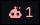
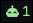
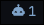
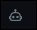

<p align="center">
  
</p>
<h1 align="center">keeptabs</h1>
<p align="center">
  <a href="https://github.com/uhs-robert/keeptabs/stargazers"></a>
  <a href="https://github.com/uhs-robert/keeptabs/issues"></a>
  <a href="https://github.com/uhs-robert/keeptabs/contributors"></a>
  <a href="https://github.com/uhs-robert/keeptabs/network/members"></a>
</p>
<p align="center">Keep tabs on your AI coding agents.</p>

## 🤖 Overview

keeptabs shows which of your Claude Code and Codex sessions are busy, finished, or waiting on you, and jumps straight to the one you pick.

<https://github.com/user-attachments/assets/fd34f99f-05ff-4174-b0f9-0d9b328759b1>

<p align=center><i>For Hyprland: supports kitty windows, tmux panes, or nvim terminal buffers.</i></p>

## ✨ Features

- **Waybar module**: shows an icon per state with a count: when busy the icon bobs up and down, pulses when waiting on you, and hides automatically when no agents are running.
- **Jump to an Agent, Anywhere**: a rofi list of every session with its state, title, project, location, and age. Picking one directly focuses the pane/buffer within a window, a lone session skips rofi.
- **Seen tracking**: statuses update whenever you look at the window, however you get there. So, statuses clear automatically and only new actionable information is displayed.

|                                                         Icon                                                          | State   | Meaning                                        |
| :-------------------------------------------------------------------------------------------------------------------: | ------- | ---------------------------------------------- |
|  | waiting | needs you now: a permission prompt or question |
|        | done    | finished its turn and you have not looked yet  |
|  | running | working                                        |
|        | idle    | started or seen, nothing happening             |

## 📌 Requirements

| Dependency | Required | Notes                        |
| ---------- | -------- | ---------------------------- |
| Hyprland   | yes      |                              |
| `jq`       | yes      |                              |
| `rofi`     | yes      |                              |
| bash       | yes      | 5.1+                         |
| Waybar     | yes      | for the bar module           |
| tmux       | optional | needs `focus-events on`      |
| kitty      | optional | needs `listen_on`, see below |
| nvim       | optional |                              |

## 🚀 Install

```sh
git clone https://github.com/uhs-robert/keeptabs
cd keeptabs
make install            # copies into ~/.local; PREFIX=/usr/local to change
# make link             # symlinks instead, for hacking on it
```

> [!IMPORTANT]
> Make sure `~/.local/bin` is on your `PATH`, including for the shells your agents run hooks in.

## 📦 Setup

Every file below is in [`examples/`](examples).

### 🚀 Required

#### **Agent hooks**

- Merge [`claude-settings.json`](examples/claude-settings.json) into `~/.claude/settings.json`, keeping any hooks you already have
- Merge [`codex-hooks.json`](examples/codex-hooks.json) to `~/.codex/hooks.json`. In Codex, run `/hooks` to trust them.

#### **Waybar**

The status indicator on your bar to show agent state and activate picker with click.

- Add [`waybar-module.jsonc`](examples/waybar-module.jsonc) to your config and put `custom/keeptabs` in a bar's modules list
- Append [`waybar-style.css`](examples/waybar-style.css) to your stylesheet and reload.

### 🍭 Optional

#### **Hyprland Keybind**

Keyboard shortcut to the `keeptabs` picker to pick an active agent session.

- Bind `SUPER CTRL + A` to the picker with [`hyprland.lua`](examples/hyprland.lua), or [`hyprland.conf`](examples/hyprland.conf) on a classic config.

#### **kitty**

Allows `keeptabs` to focus an agent inside a kitty window or inside NeoVim.

- Add [`kitty.conf`](examples/kitty.conf) and restart it.
- All kitty windows share one process, and its remote control socket is how keeptabs tells them apart.

#### **tmux**

Allows `keeptabs` to focus an ai agent pane in tmux.

- Add [`tmux.conf`](examples/tmux.conf) so tmux reports which client has focus.
- Use `~/.config/tmux/tmux.conf` instead if that is where yours lives.

## 🎨 Configuration

Colors are optional. Copy [`config.ini`](examples/config.ini) to `~/.config/keeptabs/config.ini` and change any of them:

```ini
[colors]
waiting = #FFA0A0
done    = #A3E39A
running = #7FA3C9
idle    = #717A84
muted   = #717A84
```

The picker reads it each time it opens, and the Waybar module picks up changes within a couple of seconds. Colors must be `#RRGGBB`; anything else falls back to the default. Keys and section names are case-insensitive, and comments start with `#` or `;`, on their own line or after a value. The module's `.waiting`, `.done`, and similar classes are still there for CSS if you want to style the whole module.

## 🔌 Other frontends

`keeptabs-pick` supports two flags for building a picker other than rofi:

- `keeptabs-pick --json` prints the session list as a JSON array, each session's state-file fields plus `project` (its `cwd`'s basename), `where` (the same location string the rofi row shows), and `context_used`/`context_window`/`context_pct` (tokens used, the model's context window, and the percent used, all `null` until the transcript has usage to report).
- `keeptabs-pick --focus <id>` jumps straight to the session with that `id`, running the same seen hook, tmux, window, and nvim focus steps rofi would.
- `keeptabs-status` prints one Waybar JSON line per frame. Besides `text`, `class`, and `tooltip`, it emits a `finished_seq` field: a counter that goes up by the number of sessions that just went from running to done. A frontend other than Waybar can watch for it changing instead of diffing tooltip counts. For a few seconds after that transition, `class` also becomes an array with `finished` added (e.g. `["done", "finished"]`) so Waybar CSS can animate the change; see `.finished` in [`waybar-style.css`](examples/waybar-style.css). A `waiting_seq` field works the same way for sessions that just started waiting on you, pairing with a transient `waiting-started` class entry (e.g. `["waiting", "waiting-started"]`, or `["waiting", "finished", "waiting-started"]` if both fire at once); see `.waiting-started` and `.waiting` in [`waybar-style.css`](examples/waybar-style.css).

## 🪟 tmux status lines

The hook also writes each session's state into tmux, so a tmux theme can style the windows that hold agents. Two options carry it:

- `@keeptabs_state` (window option): `waiting`, `done`, `running`, or `idle`, the most urgent state (in that order) of the live sessions with a pane in that window. It is unset when the window has no live session. Only sessions on the same tmux server count.
- `@keeptabs_frame` (global option): `0` or `1`. It flips about once a second while any session on that server is running or done, so a theme can animate those windows. With no running or done session, it keeps its last value.

The hook updates `@keeptabs_state` on every state change. Ticks of `keeptabs-status --once` flip `@keeptabs_frame`, so run it from your status line:

```tmux
set -g status-interval 1
set -ga status-right '#(keeptabs-status --once)'
```

`keeptabs-status --once` prints nothing and returns in a few milliseconds. When no other `keeptabs-status` is running, each tick also does the watcher's work: it marks interrupted sessions done, marks the session you are looking at seen, and clears windows whose agent exited without ending its session. While a continuous `keeptabs-status` runs (the Waybar module or another bar), that instance does this and `--once` only flips the frame. Read the options in formats, for example `#{?#{==:#{@keeptabs_state},waiting},#[fg=red],}` in `window-status-format`.

### Jump to the agent that needs you

`keeptabs-tmux next` goes to the pane of the agent on the current tmux server that needs you most. It picks agents waiting on you before finished ones, and the oldest first within each. Press it again to walk through the rest in the same order. It skips the pane you are already in, and shows "No agent needs you" when there is nothing to go to. It needs only bash and tmux, so it works on a headless server:

```tmux
bind-key a run-shell -b 'keeptabs-tmux next'
```

## 🚩 Caveats

- Window focusing is Hyprland only.
- Claude Code has no hook for `Esc` during a reply, so keeptabs reads Claude's own session status file in `~/.claude/sessions/`. That file is undocumented and may change between Claude Code releases.
